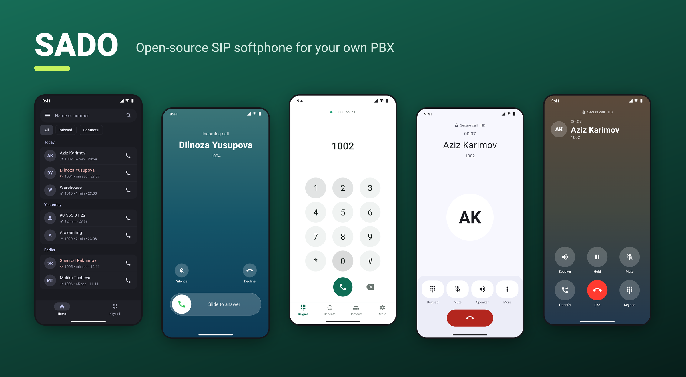
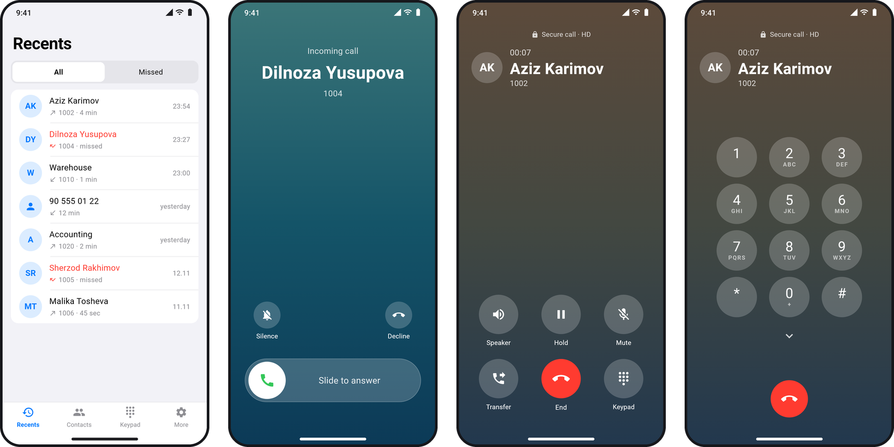
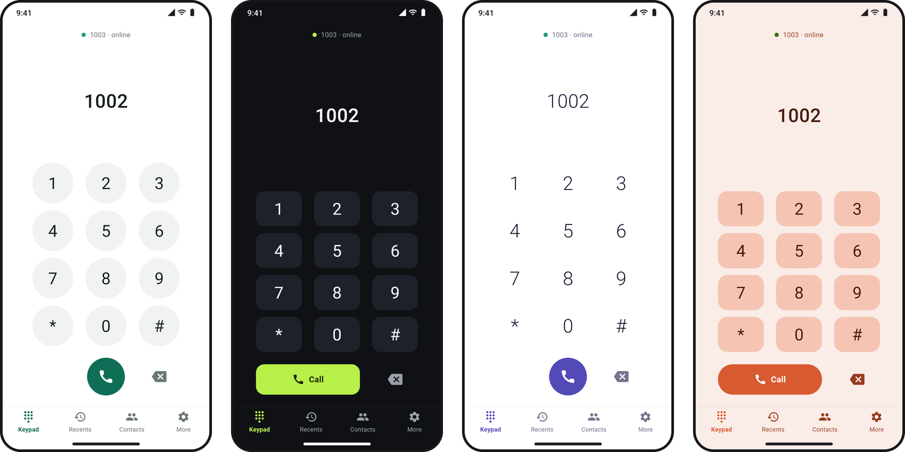

<p align="center">
  
</p>

<h1 align="center">SADO — open-source SIP softphone for Android</h1>

<p align="center">
  A free, ad-free VoIP phone app for <b>your own PBX</b> — Asterisk, FreePBX, Kamailio, FreeSWITCH and other
  servers that speak SIP over WebSocket. Built with Flutter.
</p>

<p align="center">
  <a href="LICENSE"></a>
  
  
  
</p>

<p align="center">
  <b>English</b> · <a href="README.ru.md">Русский</a>
</p>

---

## What it is

SADO is a softphone: an app that turns an Android phone into an extension of your office phone system.
You enter the address of your PBX, your extension number and password — and make and receive calls over
Wi-Fi or mobile data, with no SIM card involved.

- **No accounts, no cloud, no tracking.** The app talks only to the server you type in. No analytics,
  no ads, no third-party servers (not even a public STUN server).
- **Encrypted.** Signalling goes over `wss://` (TLS); audio is always encrypted (WebRTC, DTLS-SRTP).
- **HD voice.** Opus and G.722 wideband codecs, with G.711 as a fallback.
- **Looks the way you like.** Six visual styles, light and dark themes, four ways to answer a call.

> **Try it without a server:** tap *“Try without a server”* on the sign-in screen — the demo mode
> shows every screen with sample data and simulated calls.

## Features

**Calls**
- Outgoing and incoming calls, call history, missed calls
- Hold, mute, speakerphone, in-call keypad (DTMF, RFC 2833)
- Blind call transfer
- Do Not Disturb (callers hear “busy”), silence the ringer for a single call
- Redial: the call button on an empty field brings back the last number
- Choose where the sound goes: earpiece, speaker, Bluetooth headset or wired headphones
- Opens `tel:` and `sip:` links from the browser and other apps (the number is filled in; you press Call)

**Works like a phone**
- Stays registered in the background and rings when the app is closed or the phone is locked
- Full-screen incoming call over the lock screen, heads-up notification with *Answer* / *Decline*
- Ongoing-call notification with *Hang up*; the screen turns off when the phone is at your ear
- Missed-call notification; your own choice of ringtone and vibration
- Starts by itself after the phone reboots
- Calls start in the earpiece (or a connected headset); the speaker is one tap away

**Look and feel**
- Six styles: *Emerald*, *Night*, *Air*, *Sunset*, *Cupertino* (iOS-inspired) and *Material* (inspired by Material Design)
- Light and dark theme for every style, three icon sets
- Four ways to answer: buttons, slide to answer, swipe left/right, swipe up/down — or “match the style”
- Eight home-screen icons to choose from
- English, Russian and Uzbek interface; follows the phone language by default

**Contacts**
- Your own contact list stored on the phone: add, edit, delete, search
- Save a number straight from the call history; names show up in history and on the call screen
- Optionally show the phone's address book (read on the device each time, never copied or uploaded)

## Screenshots

### Material style — inspired by Material Design

<p align="center"></p>

### Cupertino style — inspired by iOS

<p align="center"></p>

### Emerald, Night, Air and Sunset

<p align="center"></p>

### Contacts, settings and call screens

<p align="center"></p>

### Home-screen icons

<p align="center"></p>

## Install

1. Download the latest `.apk` from the [Releases](../../releases) page.
2. Open it on the phone and allow installation from this source.
3. Enter your server, extension number and password.

For reliable incoming calls allow the app to run in the background: **More → Background calls**
has shortcuts to the right system screens (battery restriction; “autostart” on Xiaomi, Samsung, Huawei,
Oppo, Vivo and others).

## What your PBX needs

SADO connects the same way a browser softphone does:

| Requirement | Details |
|---|---|
| SIP over WebSocket | `wss://` (recommended) or `ws://`; RFC 7118 |
| WebRTC media | ICE, DTLS-SRTP |
| Codecs | Opus, G.722, PCMU or PCMA |
| DTMF | RFC 2833 / RFC 4733 |
| Reachability | The phone must reach the PBX directly (same network, VPN or public address) — no STUN/TURN is used |

Classic SIP over UDP/TCP/TLS is **not** supported — the server must offer a WebSocket transport.

<details>
<summary><b>Example: Asterisk (PJSIP)</b></summary>

```ini
; http.conf — built-in web server that carries the WebSocket
[general]
enabled=yes
tlsenable=yes
tlsbindaddr=0.0.0.0:8089
tlscertfile=/etc/asterisk/keys/fullchain.pem
tlsprivatekey=/etc/asterisk/keys/privkey.pem

; pjsip.conf
[transport-wss]
type=transport
protocol=wss
bind=0.0.0.0

[1003]
type=endpoint
aors=1003
auth=1003
webrtc=yes
context=internal
disallow=all
allow=opus,g722,ulaw,alaw

[1003]
type=auth
auth_type=userpass
username=1003
password=use-a-long-random-password

[1003]
type=aor
max_contacts=1
remove_existing=yes
```

In the app: **Server** `wss://pbx.example.com:8089/ws`, **Number** `1003`.
If you type only a host name (`pbx.example.com`), the app uses `wss://pbx.example.com/ws`.
</details>

Tested with Asterisk (PJSIP) behind a Kamailio WebSocket proxy. Other servers with SIP-over-WebSocket and
WebRTC support (FreePBX, FreeSWITCH, OpenSIPS, …) should work; reports are welcome.

## Privacy and security

- The password is stored in the Android Keystore-backed secure storage, never in plain settings.
- Call history and contacts stay on the phone and are excluded from cloud backups and device transfer.
- The app has no analytics, crash reporting or advertising SDKs and contacts no server except your PBX.
  The only exception is the **Check for updates** button in Settings: it asks GitHub for the latest release,
  and only when you tap it.
- The phone's address book is read only if you turn that on, stays in memory and is never stored or sent anywhere.
- A `ws://` address is not encrypted — the sign-in screen warns about it. Use `wss://` whenever you can.
- The web build exists for previewing the interface; a browser cannot protect a saved password the way
  Android does, so do not use it with real accounts.

Found a vulnerability? See [SECURITY.md](SECURITY.md).

## Limitations

- Android only. The Flutter code also builds for the web (preview) — iOS has not been set up.
- No push notifications: the app keeps a light background connection to the PBX instead, so it needs
  permission to run in the background.
- One call at a time: a second incoming call gets “busy”.
- No video, conference calls, attended transfer or call recording yet.
- Contacts are local; there is no directory sync with the PBX.
- Tested on a Xiaomi phone (HyperOS, Android 17). The background-permission shortcuts for other brands
  are implemented but have not been verified on real devices.

## Build from source

Requirements: [Flutter](https://docs.flutter.dev/get-started/install) 3.50 or newer, JDK 17+, Android SDK.

```bash
git clone https://github.com/dark-knight-soul/sado-softphone.git
cd sado-softphone
flutter pub get
flutter test
flutter build apk --release --split-per-abi
```

Useful extras:

```bash
# Preview in a browser (demo mode works without a server)
flutter run -d chrome

# Regenerate the README screenshots
flutter test --dart-define=SADO_SHOTS=true test/screenshots_test.dart
python tool/make_screens.py
```

Code comments and commit messages are in Russian; issues and pull requests are welcome in English or Russian.

## Tech stack

Flutter · [`sip_ua`](https://pub.dev/packages/sip_ua) (SIP over WebSocket) ·
[`flutter_webrtc`](https://pub.dev/packages/flutter_webrtc) (audio) ·
[`flutter_riverpod`](https://pub.dev/packages/flutter_riverpod) (state) ·
[`flutter_secure_storage`](https://pub.dev/packages/flutter_secure_storage) ·
Kotlin foreground service for background calls and notifications.

## License

[Apache License 2.0](LICENSE). SADO is an independent project and is not affiliated with, endorsed by or sponsored by
Apple, Google or any PBX vendor. “Cupertino” and “Material” are names of interface styles; iOS, iPhone, Android and
Material Design are trademarks of their respective owners.

All code in this repository was written for this project; it contains no code or artwork taken from Apple or
Google apps. The icons come from the [Material Icons](https://fonts.google.com/icons) font and the wordmark
uses [Roboto](https://fonts.google.com/specimen/Roboto), both under the Apache License 2.0.
