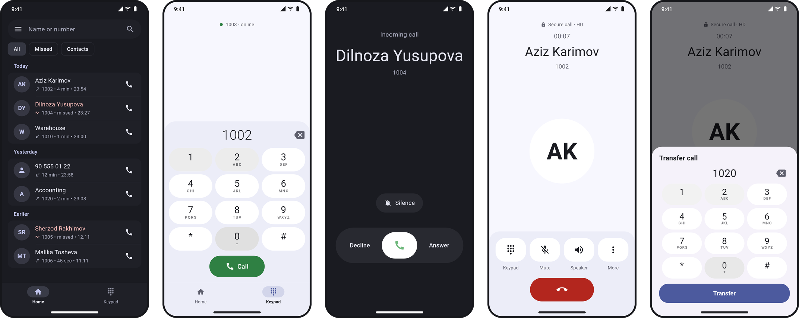
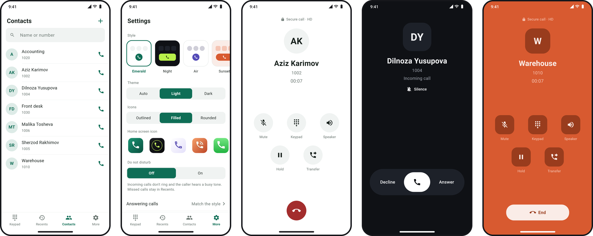
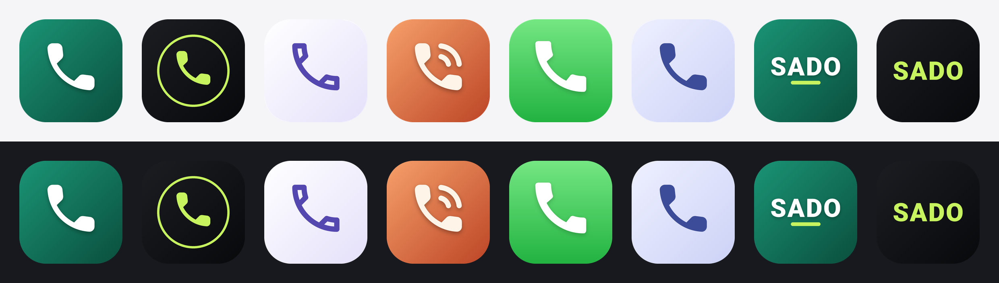

<p align="center">
  
</p>

<h1 align="center">SADO — open-source SIP softphone for Android</h1>

<p align="center">
  A free, ad-free VoIP phone app for <b>your own PBX</b> — Asterisk, FreePBX, Kamailio, FreeSWITCH and other
  servers that speak SIP over WebSocket. Built with Flutter.
</p>

<p align="center">
  <a href="LICENSE"></a>
  
  
  
</p>

<p align="center">
  <b>English</b> · <a href="README.ru.md">Русский</a>
</p>

---

## What it is

SADO is a softphone: an app that turns an Android phone into an extension of your office phone system.
You enter the address of your PBX, your extension number and password — and make and receive calls over
Wi-Fi or mobile data, with no SIM card involved.

- **No accounts, no cloud, no tracking.** The app talks only to the server you type in. No analytics,
  no ads, no third-party servers (not even a public STUN server).
- **Encrypted.** Signalling goes over `wss://` (TLS); audio is always encrypted (WebRTC, DTLS-SRTP).
- **HD voice.** Opus and G.722 wideband codecs, with G.711 as a fallback.
- **Looks the way you like.** Six visual styles, light and dark themes, four ways to answer a call.

> **Try it without a server:** tap *“Try without a server”* on the sign-in screen — the demo mode
> shows every screen with sample data and simulated calls.

## Features

**Calls**
- Outgoing and incoming calls, call history, missed calls
- Hold, mute, speakerphone, in-call keypad (DTMF, RFC 2833)
- Call transfer: immediate, or attended — talk to the colleague first, then connect the two
- Call waiting: answer a second call during a conversation and switch between the two
- Do Not Disturb (callers hear “busy”), silence the ringer for a single call
- Redial: the call button on an empty field brings back the last number
- Choose where the sound goes: earpiece, speaker, Bluetooth headset or wired headphones
- Opens `tel:` and `sip:` links from the browser and other apps (the number is filled in; you press Call)

**Works like a phone**
- Stays registered in the background and rings when the app is closed or the phone is locked
- Full-screen incoming call over the lock screen, heads-up notification with *Answer* / *Decline*
- Ongoing-call notification with *Hang up*; the screen turns off when the phone is at your ear
- Missed-call notification; your own choice of ringtone and vibration
- Starts by itself after the phone reboots
- Calls start in the earpiece (or a connected headset); the speaker is one tap away

**Look and feel**
- Six styles: *Emerald*, *Night*, *Air*, *Sunset*, *Cupertino* (iOS-inspired) and *Material* (inspired by Material Design)
- Light and dark theme for every style, three icon sets
- Four ways to answer: buttons, slide to answer, swipe left/right, swipe up/down — or “match the style”
- Eight home-screen icons to choose from
- Interface in 9 languages: English, Deutsch, Español, Français, Italiano, Português, Türkçe, Русский, Oʻzbek —
  follows the phone language by default, English if the phone language is not in the list

**Contacts**
- Your own contact list stored on the phone: add, edit, delete, search
- Save a number straight from the call history; names show up in history and on the call screen
- Optionally show the phone's address book (read on the device each time, never copied or uploaded)
- Colleague status next to your contacts — available, on a call or offline — when the PBX provides it

## Screenshots

### Material style — inspired by Material Design

<p align="center"></p>

### Cupertino style — inspired by iOS

<p align="center"></p>

### Emerald, Night, Air and Sunset

<p align="center"></p>

### Contacts, settings and call screens

<p align="center"></p>

### Home-screen icons

<p align="center"></p>

## Install

1. Download the latest `.apk` from the [Releases](../../releases) page.
2. Open it on the phone and allow installation from this source.
3. Enter your server, extension number and password — or scan a QR code with a [setup link](#setup-link-for-administrators)
   from your administrator.

For reliable incoming calls allow the app to run in the background: **More → Background calls**
has shortcuts to the right system screens (battery restriction; “autostart” on Xiaomi, Samsung, Huawei,
Oppo, Vivo and others).

## Setup link for administrators

Typing a server address and a password on a phone is the hardest part of setup. Give users a link instead —
usually as a QR code (any QR generator will do). The user taps **Sign in with QR code** on the sign-in screen
and points the camera at it — or scans it with the phone's ordinary camera, which opens SADO. Either way the
sign-in form is filled in:

```
sado://login?server=pbx.example.com%3A8089%2Fws&number=1003&password=use-a-long-random-password
```

| Parameter | Required | Value |
|---|---|---|
| `server` | yes | Host name (optionally with port and path) or a full `wss://…` / `ws://…` address |
| `number` | yes | Extension number |
| `password` | no | If omitted, the user types it |

Values must be URL-encoded. The link only fills in the form — the user still presses **Sign in**, so a link
from a stranger cannot silently register the phone somewhere else. A QR code that is not a SADO setup link is
ignored. If a camera app merely copies the text, use **Paste setup link** on the sign-in screen. Remember that a QR code with a password in it is as sensitive
as the password itself.

## What your PBX needs

SADO connects the same way a browser softphone does:

| Requirement | Details |
|---|---|
| SIP over WebSocket | `wss://` (recommended) or `ws://`; RFC 7118 |
| WebRTC media | ICE, DTLS-SRTP |
| Codecs | Opus, G.722, PCMU or PCMA |
| DTMF | RFC 2833 / RFC 4733 |
| Reachability | The phone must reach the PBX directly (same network, VPN or public address) — no STUN/TURN is used |
| Colleague status (optional) | `SUBSCRIBE` with `Event: presence`, `application/pidf+xml` (RFC 3856/3863); in Asterisk — a `hint` for each extension |

Classic SIP over UDP/TCP/TLS is **not** supported — the server must offer a WebSocket transport.

<details>
<summary><b>Example: Asterisk (PJSIP)</b></summary>

```ini
; http.conf — built-in web server that carries the WebSocket
[general]
enabled=yes
tlsenable=yes
tlsbindaddr=0.0.0.0:8089
tlscertfile=/etc/asterisk/keys/fullchain.pem
tlsprivatekey=/etc/asterisk/keys/privkey.pem

; pjsip.conf
[transport-wss]
type=transport
protocol=wss
bind=0.0.0.0

[1003]
type=endpoint
aors=1003
auth=1003
webrtc=yes
context=internal
disallow=all
allow=opus,g722,ulaw,alaw

[1003]
type=auth
auth_type=userpass
username=1003
password=use-a-long-random-password

[1003]
type=aor
max_contacts=1
remove_existing=yes
```

Optional — colleague status. A `hint` tells subscribers whether the extension is free, on a call or offline;
it is looked up in the context of the subscribing endpoint (or in its `subscribe_context`):

```ini
; extensions.conf
[internal]
exten => 1003,hint,PJSIP/1003
```

In the app: **Server** `wss://pbx.example.com:8089/ws`, **Number** `1003`.
If you type only a host name (`pbx.example.com`), the app uses `wss://pbx.example.com/ws`.
</details>

Tested with Asterisk (PJSIP) behind a Kamailio WebSocket proxy. Other servers with SIP-over-WebSocket and
WebRTC support (FreePBX, FreeSWITCH, OpenSIPS, …) should work; reports are welcome.

## Privacy and security

- The password is stored in the Android Keystore-backed secure storage, never in plain settings.
- Call history and contacts stay on the phone and are excluded from cloud backups and device transfer.
- The app has no analytics, crash reporting or advertising SDKs and contacts no server except your PBX.
  The only exception is the **Check for updates** button in Settings: it asks GitHub for the latest release,
  and only when you tap it.
- The phone's address book is read only if you turn that on, stays in memory and is never stored or sent anywhere.
- The camera is used only by the QR scanner on the sign-in screen, while that screen is open. Frames are
  decoded on the phone and are never saved or sent anywhere; without the permission everything else still works.
- A `ws://` address is not encrypted — the sign-in screen warns about it. Use `wss://` whenever you can.
- The web build exists for previewing the interface; a browser cannot protect a saved password the way
  Android does, so do not use it with real accounts.

Found a vulnerability? See [SECURITY.md](SECURITY.md).

## Limitations

- Android only. The Flutter code also builds for the web (preview) — iOS has not been set up.
- No push notifications: the app keeps a light background connection to the PBX instead, so it needs
  permission to run in the background.
- Two calls at most: a third incoming call gets “busy”.
- No video, conference calls or call recording yet.
- Call waiting and attended transfer are new in 1.2.0 and have been exercised only against the built-in test
  engine so far; behaviour with a particular PBX may need fixes — please report.
- Contacts are local; there is no directory sync with the PBX.
- Tested on a Xiaomi phone (HyperOS, Android 17). The background-permission shortcuts for other brands
  are implemented but have not been verified on real devices.

## Build from source

Requirements: [Flutter](https://docs.flutter.dev/get-started/install) 3.50 or newer, JDK 17+, Android SDK.

```bash
git clone https://github.com/dark-knight-soul/sado-softphone.git
cd sado-softphone
flutter pub get
flutter test
flutter build apk --release --split-per-abi
```

This builds the default `foss` flavor, which contains no Google libraries. A second flavor, `gms`
(`--flavor gms`), adds Firebase Cloud Messaging and needs your own `google-services.json` in `android/app`.
It enables an experimental **Wake on call** mode (Settings → Background calls): instead of staying connected,
the app goes offline when idle and the PBX wakes the phone with a push notification when a call comes in.

The PBX has to support it. The app registers with the RFC 8599 parameters in its Contact —
`pn-provider=fcm; pn-param=<Firebase project>; pn-prid=<device token>` — and removes its registration when it
goes to sleep, so the PBX must remember the token. On an incoming call the PBX sends a high-priority FCM data
message `{"type":"wake"}` from that Firebase project, waits for the phone to register (a few seconds) and then
delivers the call as usual. The push carries no call details. This mode has been checked against a real PBX only
up to the registration exchange; the push delivery itself has not been verified on a device yet.

Useful extras:

```bash
# Preview in a browser (demo mode works without a server)
flutter run -d chrome

# Regenerate the README screenshots
flutter test --dart-define=SADO_SHOTS=true test/screenshots_test.dart
python tool/make_screens.py

# Check the call engine against your own Asterisk without a phone (settings: see the top of the script)
python tool/stand_check/run.py
```

`tool/stand_check` runs the app's real call engine in headless Chrome with a fake microphone and walks through
registration, calls, hold, call waiting, attended transfer and colleague status on a live PBX. It checks the SIP
exchange, not the audio and not the Android code.

Code comments and commit messages are in Russian; issues and pull requests are welcome in English or Russian.

## Tech stack

Flutter · [`sip_ua`](https://pub.dev/packages/sip_ua) (SIP over WebSocket) ·
[`flutter_webrtc`](https://pub.dev/packages/flutter_webrtc) (audio) ·
[`flutter_riverpod`](https://pub.dev/packages/flutter_riverpod) (state) ·
[`flutter_secure_storage`](https://pub.dev/packages/flutter_secure_storage) ·
Kotlin foreground service for background calls and notifications ·
CameraX and [ZXing](https://github.com/zxing/zxing) for the on-device QR scanner.

## License

[Apache License 2.0](LICENSE). SADO is an independent project and is not affiliated with, endorsed by or sponsored by
Apple, Google or any PBX vendor. “Cupertino” and “Material” are names of interface styles; iOS, iPhone, Android and
Material Design are trademarks of their respective owners.

All code in this repository was written for this project; it contains no code or artwork taken from Apple or
Google apps. The icons come from the [Material Icons](https://fonts.google.com/icons) font and the wordmark
uses [Roboto](https://fonts.google.com/specimen/Roboto), both under the Apache License 2.0.
