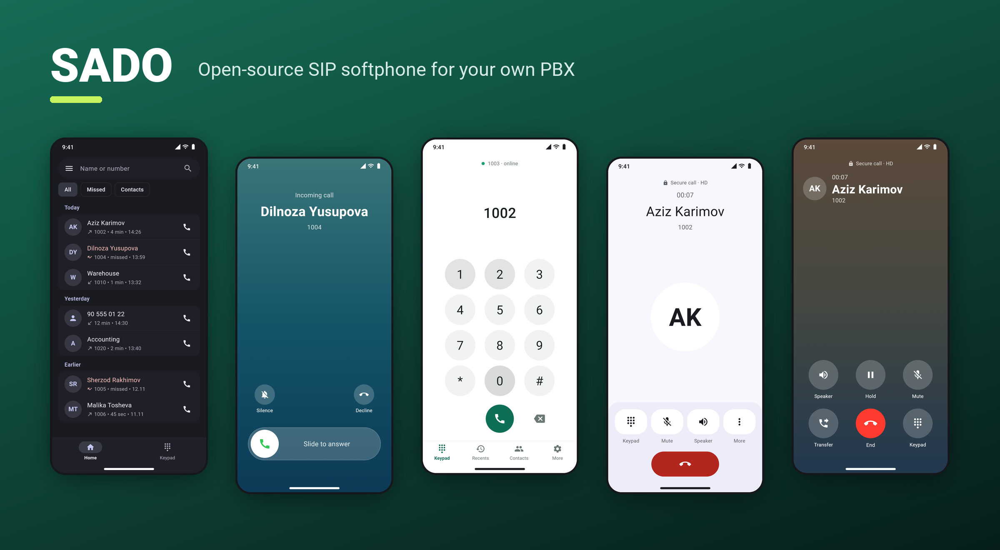
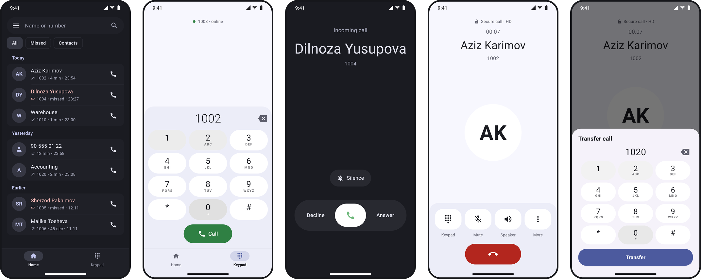
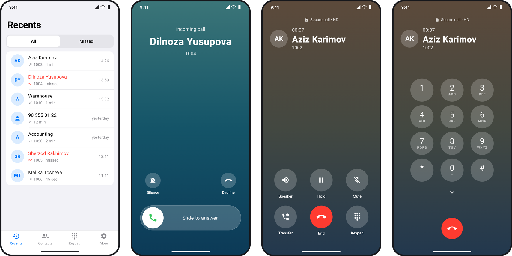
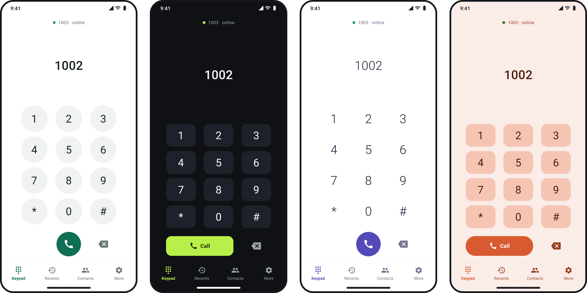
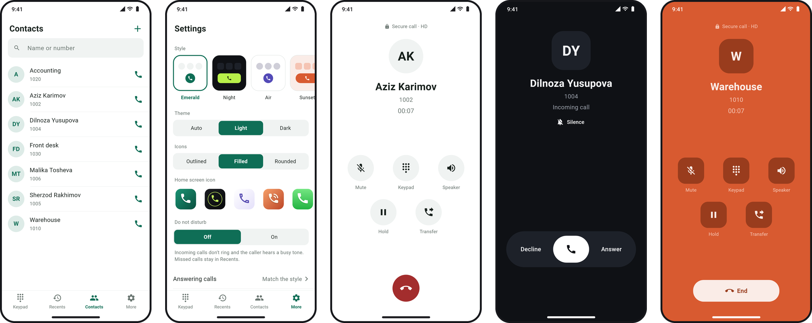
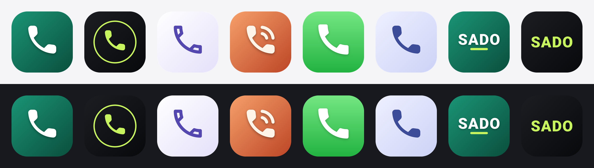

<p align="center">
  
</p>

<h1 align="center">SADO — открытый SIP-софтфон для Android</h1>

<p align="center">
  Бесплатная звонилка без рекламы для <b>своей АТС</b> — Asterisk, FreePBX, Kamailio, FreeSWITCH и других
  серверов, которые умеют SIP поверх WebSocket. Написана на Flutter.
</p>

<p align="center">
  <a href="README.md">English</a> · <b>Русский</b>
</p>

---

## Что это

SADO — софтфон: приложение, которое превращает телефон на Android во внутренний номер вашей офисной АТС.
Вводите адрес сервера, номер и пароль — и звоните и принимаете звонки через Wi-Fi или мобильный интернет,
без сим-карты.

- **Без учётных записей, облаков и слежки.** Приложение общается только с тем сервером, который вы указали.
  Ни аналитики, ни рекламы, ни посторонних серверов (даже общего STUN-сервера).
- **Шифрование.** Служебный канал идёт по `wss://` (TLS); звук шифруется всегда (WebRTC, DTLS-SRTP).
- **Звук высокой чёткости.** Кодеки Opus и G.722, запасной вариант — G.711.
- **Выглядит так, как вам нравится.** Шесть стилей оформления, светлая и тёмная темы, четыре способа ответа.

> **Посмотреть без сервера:** на экране входа нажмите «Посмотреть без сервера» — демонстрация покажет
> все экраны с образцом данных и ненастоящими звонками.

## Возможности

**Звонки**
- Исходящие и входящие, история, пропущенные
- Удержание, выключение микрофона, громкая связь, клавиши во время разговора (DTMF, RFC 2833)
- Перевод звонка: сразу или с консультацией — сначала поговорить с коллегой, потом соединить
- Второй звонок: ответить на него во время разговора и переключаться между двумя
- «Не беспокоить» (звонящий слышит «занято»), «Без звука» для одного входящего
- Повтор: кнопка вызова при пустом поле подставляет последний номер
- Выбор, куда идёт звук: телефон, динамик, Bluetooth-гарнитура или наушники
- Открывает ссылки `tel:` и `sip:` из браузера и других приложений (номер подставляется, звоните вы сами)

**Работает как телефон**
- Остаётся на связи в фоне и звонит, когда приложение закрыто или телефон заблокирован
- Входящий на весь экран поверх блокировки, всплывающее уведомление с «Ответить» / «Отклонить»
- Уведомление о разговоре с кнопкой «Завершить»; экран гаснет, когда телефон у уха
- Уведомление о пропущенных; своя мелодия и вибрация для входящих
- Само выходит на связь после перезагрузки телефона
- Разговор начинается в разговорном динамике (или в гарнитуре); громкая связь — одним нажатием

**Оформление**
- Шесть стилей: «Изумруд», «Ночь», «Воздух», «Закат», «Купертино» (в духе iOS) и «Материал» (в духе Material Design)
- Светлая и тёмная тема у каждого стиля, три набора значков
- Четыре способа ответа: кнопки, ползунок, свайп в стороны, свайп вверх-вниз — или «как в стиле»
- Восемь значков для рабочего стола на выбор
- Интерфейс на 9 языках: русский, узбекский, английский, немецкий, испанский, французский, итальянский,
  португальский, турецкий; по умолчанию — как в телефоне, а если такого языка нет — английский

**Контакты**
- Своя записная книжка на телефоне: добавить, изменить, удалить, найти
- Сохранение номера прямо из истории; имена видны в истории и на экране звонка
- По желанию — контакты из телефонной книги (читаются на телефоне каждый раз заново, никуда не копируются)

## Снимки экрана

### Стиль «Материал» — в духе Material Design

<p align="center"></p>

### Стиль «Купертино» — в духе iOS

<p align="center"></p>

### «Изумруд», «Ночь», «Воздух» и «Закат»

<p align="center"></p>

### Контакты, настройки и экраны звонка

<p align="center"></p>

### Значки для рабочего стола

<p align="center"></p>

## Установка

1. Скачайте свежий `.apk` со страницы [Releases](../../releases).
2. Откройте его на телефоне и разрешите установку из этого источника.
3. Введите сервер, номер и пароль — или откройте [ссылку настройки](#ссылка-настройки-для-администраторов)
   от администратора.

Чтобы входящие доходили надёжно, разрешите приложению работать в фоне: в разделе **Ещё → Звонки в фоне**
есть кнопки, которые открывают нужные системные экраны (ограничение батареи; «автозапуск» на Xiaomi,
Samsung, Huawei, Oppo, Vivo и других).

## Ссылка настройки для администраторов

Вводить адрес сервера и пароль на телефоне — самое неудобное в настройке. Вместо этого выдайте ссылку,
обычно QR-кодом (подойдёт любой генератор). Сотрудник наводит обычную камеру телефона — открывается SADO
с заполненной формой входа:

```
sado://login?server=pbx.example.com%3A8089%2Fws&number=1003&password=dlinnyy-sluchaynyy-parol
```

| Параметр | Обязателен | Значение |
|---|---|---|
| `server` | да | Имя сервера (можно с портом и путём) или полный адрес `wss://…` / `ws://…` |
| `number` | да | Внутренний номер |
| `password` | нет | Без него сотрудник введёт пароль сам |

Значения кодируются как в адресах (`%XX`). Ссылка только заполняет форму — «Войти» нажимает человек, поэтому
чужая ссылка не может молча подключить телефон к постороннему серверу. Если камера лишь копирует текст,
поможет кнопка «Вставить ссылку настройки» на экране входа. QR-код с паролем так же секретен, как сам пароль.

## Что нужно от АТС

SADO подключается так же, как софтфон в браузере:

| Требование | Подробности |
|---|---|
| SIP поверх WebSocket | `wss://` (лучше) или `ws://`; RFC 7118 |
| Звук WebRTC | ICE, DTLS-SRTP |
| Кодеки | Opus, G.722, PCMU или PCMA |
| DTMF | RFC 2833 / RFC 4733 |
| Доступность | Телефон должен видеть АТС напрямую (одна сеть, VPN или внешний адрес) — STUN/TURN не используются |

Обычный SIP по UDP/TCP/TLS **не поддерживается** — на сервере должен быть включён WebSocket.

Пример настройки Asterisk (PJSIP) — в [английском описании](README.md#what-your-pbx-needs).
В приложении: **Сервер** `wss://pbx.example.com:8089/ws`, **Номер** `1003`. Если ввести только имя
(`pbx.example.com`), приложение само возьмёт `wss://pbx.example.com/ws`.

Проверено с Asterisk (PJSIP) за Kamailio. Другие серверы с SIP поверх WebSocket и WebRTC (FreePBX,
FreeSWITCH, OpenSIPS…) должны работать; сообщения о результатах приветствуются.

## Приватность и безопасность

- Пароль лежит в защищённом хранилище Android (ключ в Keystore), а не в обычных настройках.
- История звонков и контакты остаются на телефоне и не попадают в облачные копии и перенос на другой телефон.
- В приложении нет аналитики, отчётов о сбоях и рекламы; оно не обращается ни к одному серверу, кроме вашей АТС.
  Единственное исключение — кнопка «Проверить обновления» в настройках: она спрашивает у GitHub номер свежей
  версии, и только когда вы её нажали.
- Телефонная книга читается, только если вы это включили; контакты держатся в памяти и нигде не сохраняются.
- Адрес `ws://` не шифруется — экран входа об этом предупреждает. По возможности используйте `wss://`.
- Версия для браузера нужна, чтобы посмотреть интерфейс: браузер не может защитить сохранённый пароль так,
  как Android, поэтому с настоящими учётными записями её использовать не стоит.

Нашли уязвимость? См. [SECURITY.md](SECURITY.md).

## Ограничения

- Только Android. Код собирается и для браузера (для просмотра); iOS не настраивался.
- Нет push-уведомлений: вместо них приложение держит лёгкое фоновое соединение с АТС, поэтому ему нужно
  разрешение на работу в фоне.
- Не больше двух звонков: третий входящий получает «занято».
- Пока нет видео, конференций и записи разговора.
- Второй звонок и перевод с консультацией появились в 1.2.0 и пока проверены только на встроенном учебном
  движке; с конкретной АТС могут понадобиться исправления — сообщайте.
- Контакты только свои, на телефоне; списка сотрудников с АТС нет.
- Проверено на телефоне Xiaomi (HyperOS, Android 17). Кнопки «работа в фоне» для других производителей
  сделаны, но на настоящих устройствах не проверялись.

## Сборка из исходников

Нужны: [Flutter](https://docs.flutter.dev/get-started/install) 3.50 или новее, JDK 17+, Android SDK.

```bash
git clone https://github.com/dark-knight-soul/sado-softphone.git
cd sado-softphone
flutter pub get
flutter test
flutter build apk --release --split-per-abi
```

Дополнительно:

```bash
# Посмотреть в браузере (демонстрация работает без сервера)
flutter run -d chrome

# Пересоздать снимки экрана для описания
flutter test --dart-define=SADO_SHOTS=true test/screenshots_test.dart
python tool/make_screens.py
```

Комментарии в коде и сообщения коммитов — на русском; задачи и предложения принимаются на русском и английском.

## На чём сделано

Flutter · [`sip_ua`](https://pub.dev/packages/sip_ua) (SIP поверх WebSocket) ·
[`flutter_webrtc`](https://pub.dev/packages/flutter_webrtc) (звук) ·
[`flutter_riverpod`](https://pub.dev/packages/flutter_riverpod) (состояние) ·
[`flutter_secure_storage`](https://pub.dev/packages/flutter_secure_storage) ·
фоновая служба на Kotlin для звонков в фоне и уведомлений.

## Лицензия

[Apache License 2.0](LICENSE). SADO — независимый проект; он не связан с Apple, Google и производителями АТС и не одобрен
ими. «Купертино» и «Материал» — названия стилей оформления; iOS, iPhone, Android и Material Design —
товарные знаки их владельцев.

Весь код в этом репозитории написан для этого проекта; в нём нет кода и изображений из приложений Apple
и Google. Значки взяты из шрифта [Material Icons](https://fonts.google.com/icons), надпись на значке набрана
шрифтом [Roboto](https://fonts.google.com/specimen/Roboto) — оба под лицензией Apache 2.0.
